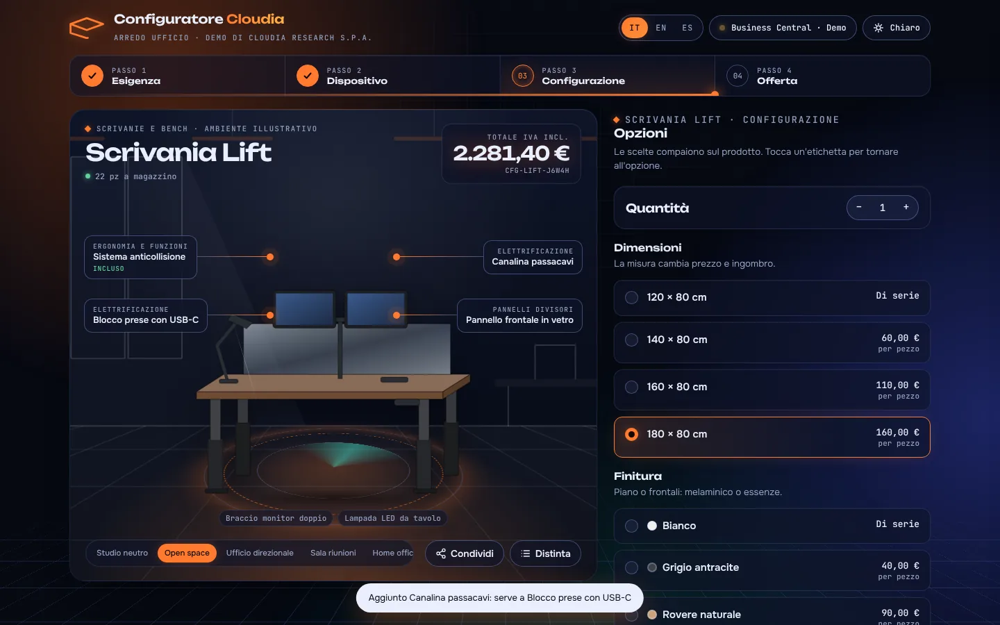

# Configuratore Cloudia

Configuratore di prodotto demo di **Cloudia Research S.p.A.**, integrabile con Microsoft Dynamics 365 Business Central.

Il catalogo è di fantasia (arredo ufficio) e serve a mostrare il configuratore come applicazione standalone a qualsiasi prospect. È disponibile in italiano, inglese (US) e spagnolo, con tema chiaro e scuro.



## Cosa mostra

- **Configurazione guidata in 4 passi:** famiglia di prodotto, modello, configurazione e offerta.
- **Palcoscenico prodotto:** il prodotto è disegnato dal codice (SVG parametrico) e cambia subito con misure, finiture, colore struttura, tessuti e accessori.
- **Ambienti d'uso illustrati:** open space, ufficio direzionale, sala riunioni, home office e studio neutro.
- **Motore regole:**
  - i requisiti vengono aggiunti in automatico (il blocco prese aggiunge la canalina);
  - alcune opzioni si escludono a vicenda (pannello vetro o tessuto, braccio monitor singolo o doppio);
  - alcuni componenti sono inclusi nel prodotto (canalina nel bench, montaggio nel booth);
  - le opzioni di scelta singola hanno un valore preselezionato.
- **Prezzi:** sconto quantità (5%, 8%, 12%), gruppi prezzi cliente (listino, grandi aziende, rivenditore) e IVA 22%.
- **Distinta:** pannello laterale con vista tecnica in pianta e quote in cm.
- **Condivisione:** link e QR code che ricaricano la configurazione.
- **Offerta verso Business Central:** modalità Demo (simulata) e Live (tramite proxy), con payload per `salesQuotes` e `salesQuoteLines`.

## Struttura

| Cartella | Contenuto |
|---|---|
| `webapp/` | L'app: un unico `index.html` con HTML, CSS e JavaScript. Non richiede build. |
| `tests/` | Test di regole, prezzi, scenari e copertura delle traduzioni (Node.js, nessuna dipendenza). |
| `tools/` | `export-artifact.py`: converte `index.html` nel formato per la pubblicazione su claude.ai. |
| `docs/` | Screenshot. |

## Avvio

- Apri `webapp/index.html` nel browser, oppure usa Live Server in VS Code (radice già impostata su `webapp/`).
- `npm test` esegue i test.
- Per pubblicarla su Netlify trascina una cartella che contiene `index.html` nella pagina *Deploys* del sito.

## Dove si modifica cosa

Tutto è in `webapp/index.html`:

- `/*ENGINE_START*/ … /*ENGINE_END*/`: catalogo (`P`), opzioni (`O`), regole, prezzi, avvisi e scenari demo (`PRESETS`).
- `/*I18N_START*/ … /*I18N_END*/`: il nome dell'azienda (`COMPANY`, `SHORT`), i testi dell'interfaccia (`UI`) e le traduzioni del catalogo (`TR`).
- `drawProduct` e le funzioni `draw*`: i disegni dei prodotti. Le opzioni con `sw` (colore) o `v` (misure) cambiano il disegno.
- `SCENE_SVG`: gli ambienti illustrati.

Per riusare la demo su un altro settore basta sostituire catalogo, traduzioni e disegni: il motore e l'interfaccia restano gli stessi.

## Integrazione con Business Central

```
Browser (webapp)  ──►  Proxy / BFF  ──►  Business Central API
                       aggiunge il token OAuth2
```

- **Catalogo e regole:** `GET /api/cloudia/configurator/v1.0/companies({id})/configItems`, da un'API page custom.
- **Prezzi e giacenze:** `GET /api/v2.0/companies({id})/items`.
- **Offerta:** `POST /salesQuotes`, poi `POST /salesQuotes({id})/salesQuoteLines`.

Il token non vive mai nella pagina. In modalità Demo nessuna chiamata raggiunge Business Central.
